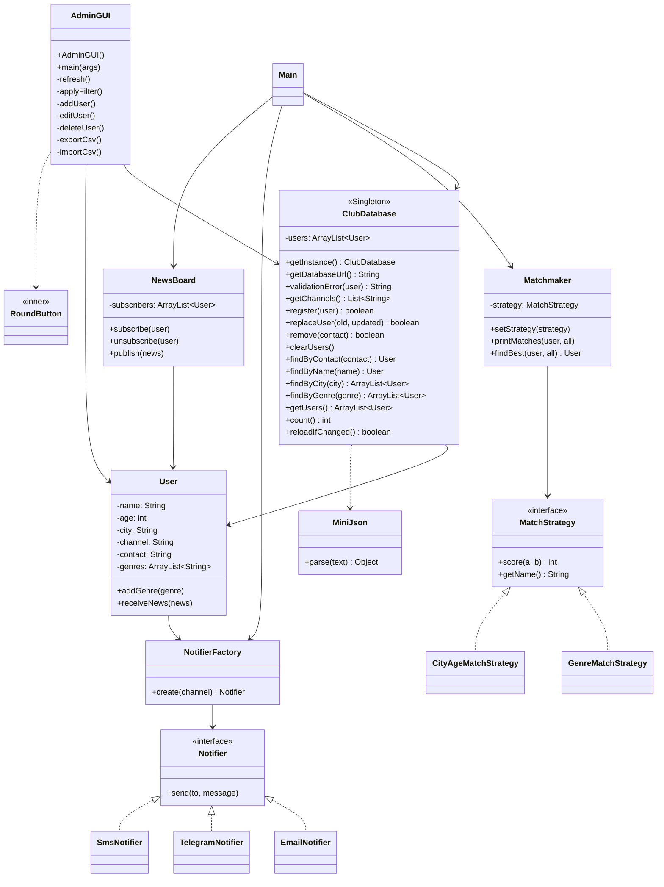

# Teamwork

## Команда
1. Erasul Mulaev
2. Baizhuma Rustem
3. Auelbek Bakytzhan
4. Nurlanov Marlen

## Жоба сипаттамасы 

Бұл жоба — жас книголюбтарға арналған танысу клубының жеңілдетілген нұсқасы.  
Негізгі мақсат: қатысушыларды тіркеу, қызығушылықтарына қарай жұп табу, әртүрлі байланыс арналары арқылы хабарлама жіберу және клуб жаңалықтарын тарату.

Жоба ішінде келесі паттерндер қолданылады:

1. **Singleton** — `ClubDatabase`  
   Қатысушылардың ортақ дерекқоры бір ғана объект ретінде жұмыс істейді.

2. **Factory** — `NotifierFactory`  
   Байланыс арнасына (`email`, `telegram`, `sms`) қарай тиісті хабарлама жіберуші объект жасайды.

3. **Strategy** — `MatchStrategy`  
   Жұп таңдау алгоритмін ауыстыруға болады (`GenreMatchStrategy`, `CityAgeMatchStrategy`).

4. **Observer** — `NewsBoard`  
   Клуб жаңалығы жарияланғанда, барлық жазылушы пайдаланушыға хабарлама жіберіледі.

Қосымша әкімшілік терезе (`AdminGUI`) арқылы:
- қатысушыны қосу/өңдеу/өшіру,
- іздеу және сүзу,
- CSV форматына экспорт/импорт жасау
мүмкіндігі бар.

## Наша команда

### 1) Тимлид (Erasul Mulaev) — архитектура и интеграция модулей
Тимлид собрал общий сценарий работы приложения в `Main`: регистрация, подбор, уведомления и рассылка новостей.  
Он зафиксировал применение паттернов в одном потоке выполнения.

```java
ClubDatabase db = ClubDatabase.getInstance();
Matchmaker matchmaker = new Matchmaker(new GenreMatchStrategy());
Notifier n1 = NotifierFactory.create(rustem.getChannel());
NewsBoard board = new NewsBoard();
```

### 2) Developer (Baizhuma Rustem) — пользовательский функционал и GUI
Разработчик реализовал окно администратора `AdminGUI`: таблицу участников, поиск, CRUD-операции и CSV импорт/экспорт.  
Также добавил автообновление интерфейса при изменении данных.

```java
add.addActionListener(e -> addUser());
edit.addActionListener(e -> editUser());
delete.addActionListener(e -> deleteUser());
new javax.swing.Timer(1000, e -> {
    if (db.reloadIfChanged()) refresh();
}).start();
```

### 3) Database Engineer (Nurlanov Marlen) — единая база и синхронизация
Инженер по БД реализовал `ClubDatabase` как Singleton с синхронизацией данных в Firebase Realtime Database.  
Добавлены операции регистрации, замены, удаления и периодический `pull()` из облака.

```java
private static class Holder {
    private static final ClubDatabase INSTANCE = new ClubDatabase();
}

public static ClubDatabase getInstance() {
    return Holder.INSTANCE;
}
```

### 4) Security Engineer (Auelbek Bakytzhan) — валидация и защита доступа
Специалист по безопасности добавил проверку входных данных, работу с токенами Firebase Authentication и безопасную обработку ошибок.  
Критичные параметры читаются из переменных окружения, чтобы не передавать секреты в коде.

```java
if (u.getAge() < MIN_AGE || u.getAge() > MAX_AGE) {
    return "клуб для молодёжи от " + MIN_AGE + " до " + MAX_AGE + " лет";
}
if (FIREBASE_API_KEY.isEmpty() || FIREBASE_EMAIL.isEmpty() || FIREBASE_PASSWORD.isEmpty()) {
    throw new IOException("Не настроена Firebase Authentication...");
}
```

## UML (Class Diagram)


