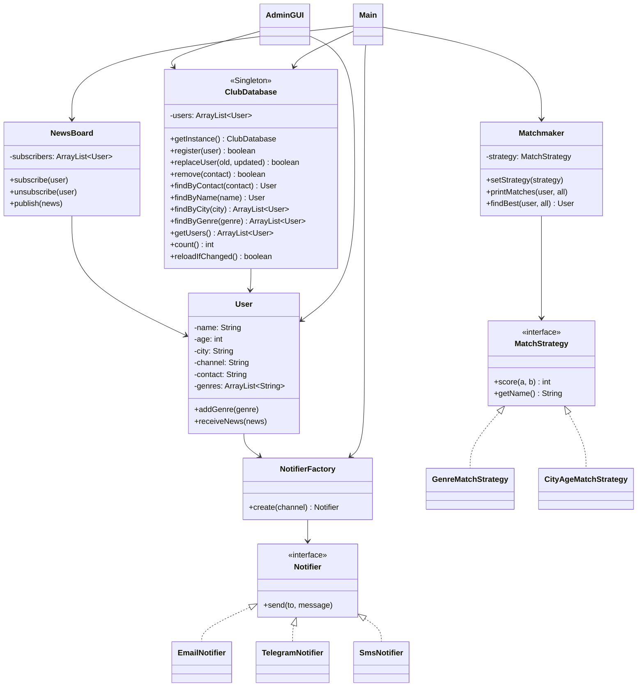

# Teamwork

## Команда
1. Erasul Mulaev
2. Baizhuma Rustem
3. Баха
4. Марлен

## Жоба сипаттамасы (қазақша)

Бұл жоба — жас книголюбтарға арналған танысу клубының жеңілдетілген нұсқасы.  
Негізгі мақсат: қатысушыларды тіркеу, қызығушылықтарына қарай жұп табу, әртүрлі байланыс арналары арқылы хабарлама жіберу және клуб жаңалықтарын тарату.

Жоба ішінде келесі паттерндер қолданылады:

1. **Singleton** — `ClubDatabase`  
   Қатысушылардың ортақ дерекқоры бір ғана объект ретінде жұмыс істейді.

2. **Factory** — `NotifierFactory`  
   Байланыс арнасына (`email`, `telegram`, `sms`) қарай тиісті хабарлама жіберуші объект жасайды.

3. **Strategy** — `MatchStrategy`  
   Жұп таңдау алгоритмін ауыстыруға болады (`GenreMatchStrategy`, `CityAgeMatchStrategy`).

4. **Observer** — `NewsBoard`  
   Клуб жаңалығы жарияланғанда, барлық жазылушы пайдаланушыға хабарлама жіберіледі.

Қосымша әкімшілік терезе (`AdminGUI`) арқылы:
- қатысушыны қосу/өңдеу/өшіру,
- іздеу және сүзу,
- CSV форматына экспорт/импорт жасау
мүмкіндігі бар.

## UML (Class Diagram)

